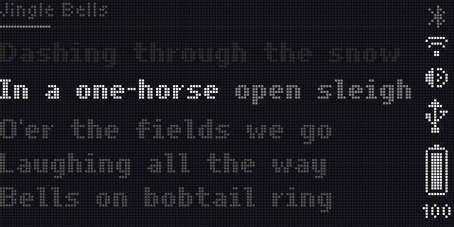

# BB Karaoke

[](https://github.com/jforatier/busy-bar-karaoke/actions/workflows/ci.yml) [](LICENSE)

Karaoke on your [BUSY Bar](https://busy.app). The bar plays the backing track through its speaker and lights the lyrics on its 72×16 front display, syllable by syllable, right on the notes, with a count-in on the beat. The back display shows the verse too, so people on both sides of the bar can sing.




> **Version 1.0.0.** Seven public-domain songs, two displays driven by the music (a comet that lands on every syllable, or giant words), the lyrics on the back display too, a count-in on the beat and an animated finale. Install it from the BUSY Apps Catalog on your bar, or take the `.tgz` from [Releases](https://github.com/jforatier/busy-bar-karaoke/releases). How the app is built and why is in [specs/](specs/00-index.md); changes are in [CHANGELOG.md](CHANGELOG.md).

## Songs: public domain only, made here

BB Karaoke ships seven songs: party classics (*Funiculì, Funiculà*, *La Cucaracha*, Offenbach's *Can-Can* sung on "ta"), Christmas carols (*Jingle Bells*, *We Wish You a Merry Christmas*, *Silent Night*) and *Au clair de la lune*. Their tunes and words are in the public domain, and their backing tracks are synthesized by this repo from scores we wrote (`songs/<id>/score.json`), so they carry no third-party rights. Details and the traps to avoid: [specs/13](specs/13-legal.md).

To add a public-domain song, write its `score.json` (tempo, chords, melody, lyrics split into syllables: format in [specs/03](specs/03-songs.md#scores)) and listen to it with `npm run preview <song-id>` (writes `dist/<song-id>.wav`).

In your own build you can also add other songs: a backing track you **bought**, plus lyrics you time yourself. Those files stay on your machine, in a git-ignored folder.

The recommended source is [karaoke-version.com](https://www.karaoke-version.com) (French site: [version-karaoke.fr](https://www.version-karaoke.fr)). It lets you build a custom mix: mute the lead vocal, keep the backing vocals, and so on. **[docs/add-your-songs.md](docs/add-your-songs.md)** explains how to prepare a mix that sounds good on the bar's small speaker.

⚠️ A purchased track is for your personal use. Do not commit it, push it to a fork, or share a build (`.tgz`) that contains it.

## Quick start

Requirements: a BUSY Bar connected over USB, **Node 24** (Node 26 is not supported by the BUSY tools), and [ffmpeg](https://ffmpeg.org) on your `PATH` (only needed for your own songs).

```sh
git clone https://github.com/jforatier/busy-bar-karaoke
cd busy-bar-karaoke
npm install
npm run build                 # also renders the songs: songs/* → .snd audio + lyrics module
npm run app:install && npm run app:run
```

On the bar, turn the wheel to choose a song and press **Start**.

**No BUSY Bar?** The official [BUSY Bar Emulator](https://github.com/busy-app/busybar-emulator) runs the bar's own firmware: start it, then `npx busy-cli app install --addr 127.0.0.1:8640` and `npx busy-cli app run --addr 127.0.0.1:8640`. It has no sound, but every screen is the bar's.

**Node version:** the BUSY tools break on Node 26. Use a version manager, e.g. [fnm](https://github.com/Schniz/fnm) (`fnm use` reads `.nvmrc`).

**Changed the app icon?** The bar's app menu keeps the old icon until a restart: **Settings → System → Power → Restart device**. Switching the bar off and on is only standby and keeps the old icon.

**Windows:** run the npm commands from PowerShell or cmd, not Git Bash. Git Bash's `tar` can't package the app (`Cannot connect to C:`). `npm install` also patches a Windows path bug in `@busy-app/cli` 0.6.0 (see `scripts/patch-busy-cli.mjs`).

Build commands and options are listed in the [`@busy-app/cli` README](https://www.npmjs.com/package/@busy-app/cli); platform rules are in [AGENTS.md](AGENTS.md).

## Controls

| Button | Song list | During a song |
|---|---|---|
| Wheel | choose a song | volume |
| Start | play | stop, back to list |
| OK | play | switch display (comet, giant words) |
| Back | quit the app | stop, back to list |

## Customize

In the BUSY app's settings for the app (listed as **Karaoke**), choose the display: **Comet** (default) or **Giant words**; OK also switches it during a song.

## Docs

- [docs/add-your-songs.md](docs/add-your-songs.md): add your own songs (karaoke-version.com mix, `song.json`, lyrics timed by ear with `npm run sync`)
- [CHANGELOG.md](CHANGELOG.md): what changed, release by release

## Contributing

Bug reports and public-domain song proposals are welcome: open an issue with one of the forms. Read [CONTRIBUTING.md](CONTRIBUTING.md) before a pull request (an issue first, the checks, a test on a bar or the emulator). During the BUSY Bar Apps Contest, outside pull requests wait until the results (mid-December 2026).

## License

[MIT](LICENSE). The bundled songs are generated by this repo from public-domain melodies.
